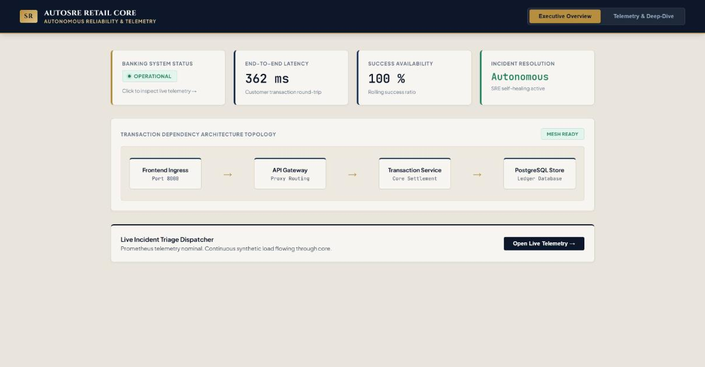
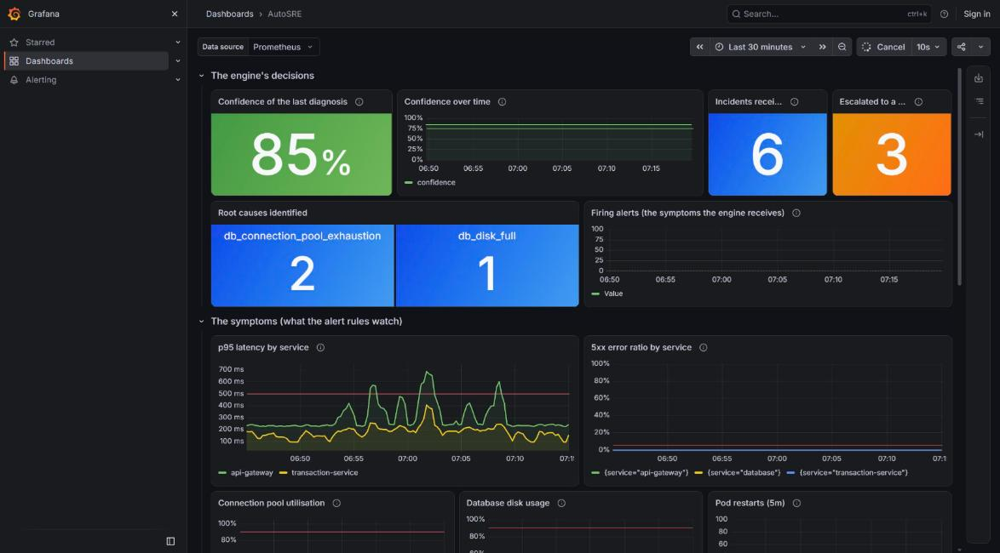
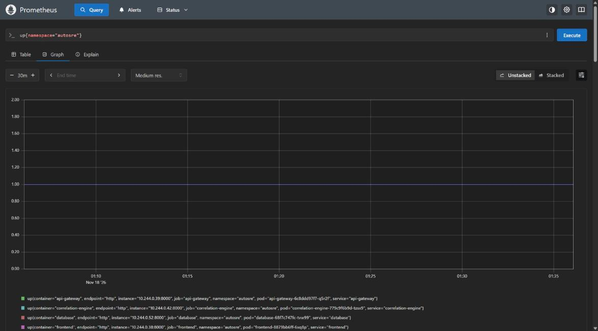
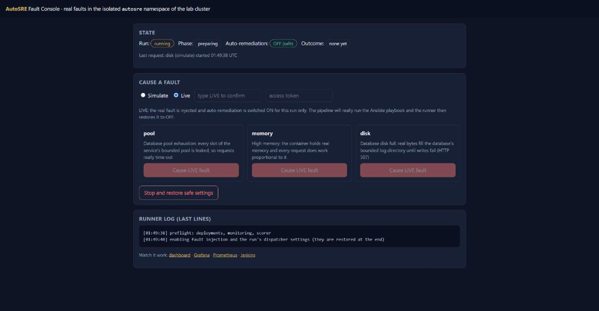
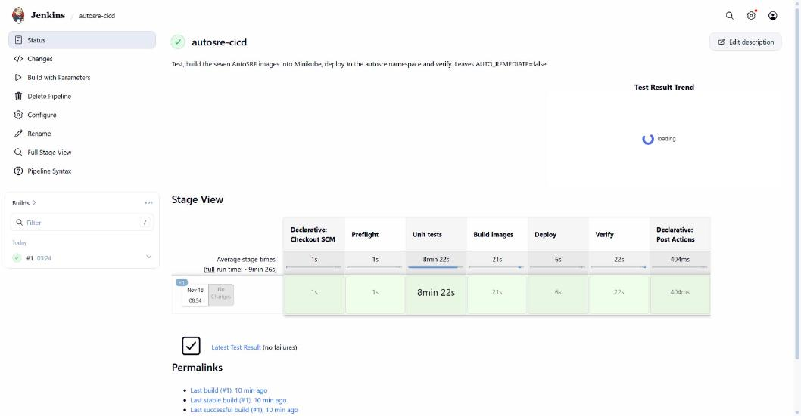
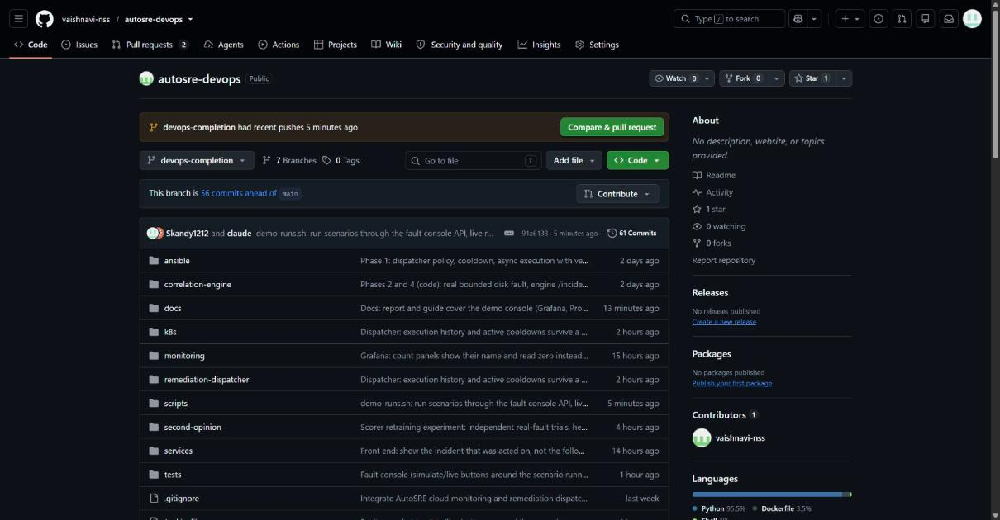

# Deploy, demonstrate, clean up and roll back

Applies to branch `devops-completion`. Everything runs in the `autosre` namespace of one Minikube cluster (a laptop, or the AWS lab
instance). Do not run any of this against a shared or production cluster.

## Start here: what was done, end to end (for the whole team)

This section is for anyone joining the project. It says what AutoSRE is, what was built and checked, what it looks like, and what is still open, without
needing to read code. The ML part has its own 10-page guide: [`AutoSRE-ML-code-and-results.pdf`](AutoSRE-ML-code-and-results.pdf).

### What AutoSRE does, in one picture

A banking-style demo app (frontend, API gateway, transaction service, database) runs on Kubernetes. When something goes wrong, AutoSRE should notice, work out why,
check itself, and fix it, or hand it to a human when it is not sure:

```
real fault -> Prometheus alert -> Alertmanager -> correlation engine (rules name the cause)
           -> ML second opinion (do the raw metrics agree?) -> dispatcher gate -> Ansible playbook -> Kubernetes recovery
```

Three faults are supported: **pool** (the database connection pool is exhausted, so requests time out), **memory** (a container holds too much memory and slows down),
**disk** (the database's log directory fills, so writes fail). Each has one approved fix: restart the service, scale it out, or clear old logs.
Anything unknown, low-confidence, disputed by the ML, or repeated inside the cooldown is escalated to a human and nothing runs.

### Where it runs

| Piece | What it is |
|---|---|
| The cluster | One Minikube (single-node Kubernetes) on one AWS Academy lab EC2 instance (`t3.large`), in an isolated `autosre` namespace. Monitoring lives in `monitoring`. |
| The code | GitHub repo `vaishnavi-nss/autosre-devops`, branch `devops-completion` (the other branches were left alone). |
| How we reach it | AWS Systems Manager (no SSH keys) and CloudShell; results are copied to an S3 bucket. |
| Browser pages (demo) | Dashboard :8081, Grafana :3000, Prometheus :9090, Fault console :8082, Jenkins :8080. Each is opened from your own IP only. |

### What was done, in order

1. **Audited** the teammate's branch: 150 tests passed, but the dispatcher (the part that actually fixes things) had no tests and no safety limits.
2. **Built the safety layer**: confidence gate (0.75), ML must agree, cooldown, one fix at a time, `AUTO_REMEDIATE=false` by default, verification after every fix.
3. **Made the faults real**: the pool fault leaks real slots, the memory fault holds real memory, the disk fault writes real bytes until writes fail with HTTP 507.
4. **Ran it on the real cluster, 14+ times**, found and fixed 14 bugs that only a real cluster shows (the report lists them), and counted results: pool 5/5, disk 4/4, memory 3 acted of 4 (1 correctly escalated).
5. **Checked the pages in a browser** (dashboard and Grafana), found four display defects, fixed them.
6. **Tested the ML honestly**: compared a public-dataset model with one trained on our own faults; retrained on real faults and found no gain (so nothing was changed).
7. **Checked the AWS side from a cold start** (instance stopped and started, cluster rebuilt): 5 of 5 scenarios passed. Removed three unrelated instances at your request.
8. **Fixed history loss**: the dispatcher now keeps its execution history and cooldowns across restarts (a small persistent volume). Proved live: after a restart the cooldown was still counting down.
9. **Added the demo console**: Grafana, Prometheus, a Fault console with Simulate / Live buttons, and a Jenkins CI/CD pipeline.

### What each page shows (screenshots in `screenshots/`)

| Page | What to look at | Screenshot |
|---|---|---|
| Dashboard (Executive) | One-glance health: status, latency, availability, the request path |  |
| Grafana, "AutoSRE" dashboard | The engine's decisions (confidence, incidents, root causes), then symptoms, then remediation and recovery |  |
| Prometheus | Raw metrics and alerts; ten prepared queries (health, alerts, pool, disk, latency, incidents, decisions, executions) |  |
| Fault console | Pick a fault, choose Simulate or Live, watch phase, auto-remediation state and the runner log |  |
| Jenkins job `autosre-cicd` | Test, build the seven images, deploy, verify (never leaves live remediation on). Build #1 succeeded |  |
| GitHub, branch `devops-completion` | 61 commits, 56 ahead of `main`; docs, scripts, tests |  |

More GitHub views are in `screenshots/` (commits, docs folder, the test report, scripts, Jenkinsfile, pull requests, branches, the ML code folder).

### Simulate versus Live (read this before pressing a button)

| | Simulate | Live |
|---|---|---|
| The fault | real, injected | real, injected |
| `AUTO_REMEDIATE` | stays **false** | switched **on for that run only**, then restored to false |
| What the system does | alerts, diagnoses, records what it *would* do | does all that **and runs the approved Ansible playbook** |
| Counts as recovery? | **No**, never reported as one | Yes, only if an independent check confirms recovery |
| Needs | the access token | the token **and** typing LIVE, **and the owner's approval** |

Only one run at a time. **Stop and restore safe settings** ends a run. A run takes about 3 to 6 minutes. Never point this at a shared or production cluster.

### Honest status (as of 2026-11-18, evening)

* **Proven on the real cluster**: all three faults detected, diagnosed, checked by the ML, fixed by Ansible, and independently verified as recovered; unknown causes escalate; the history survives a restart.
* **Proven through the fault console too (this session)**: three **Simulate** runs (alert, diagnosis, ML verdict, chosen playbook, nothing executed, not counted as recovery) and three **Live** runs that each **passed** (restart 29.2 s, scale-out 24.4 s, clear logs 23.9 s), with auto-remediation switched on only for each run and confirmed **OFF** afterwards. Screenshots `100` to `130`.
* **Jenkins pipeline built (build #1, SUCCESS in about 9.5 min)**: preflight, unit tests with no failures, build the seven images, deploy, verify (smoke test). Safe defaults held throughout. Screenshots `141` to `143`.
* **Known open items**: one ML disagreement on a real memory fault is unexplained; a memory scale-out does not remove the leak (a person must replace the pod); the lab is single-node, so timings are not production numbers; the console's status page called `kubectl` on every poll and hung once while the cluster was busy.
* **Security to fix now**: the demo ports (3000, 8080, 8081, 8082, 9090) were found open to **0.0.0.0/0** in the security group (screenshot `94`). Restrict each to your own IP or delete the rules; Jenkins and the console both use the throwaway password `password` and can change the cluster.

### If the lab session ends

The AWS Academy lab stops after about four hours and the instance's public address changes when it is restarted. After pressing **Start Lab** again: start Minikube on the instance,
run `scripts/aws/expose.sh` (the pages), check `kubectl -n autosre get deploy` shows all deployments ready, and confirm `AUTO_REMEDIATE` is `false` before anything else.
A run that was cut off may leave fault injection switched on in the two services; the launcher forces the safe defaults, or use the commands under "Clean up".

## Safe defaults (what the manifests ship with)

| Setting | Default | Where |
|---|---|---|
| `AUTO_REMEDIATE` | `false` (decisions are recorded, nothing is executed) | `k8s/remediation-dispatcher.yaml` |
| `MIN_CONFIDENCE` | `0.75` | same |
| `SECOND_OPINION_POLICY` | `agree` (the scorer must agree before anything runs) | same |
| `COOLDOWN_SECONDS` | `600` per (cause, service) | same |
| `CHAOS_ENABLED` | off on every service | `k8s/*.yaml` |
| `SECOND_OPINION_MODE` | `shadow` (the scorer annotates, never vetoes) | `k8s/correlation-engine.yaml` |
| `ESCALATE_ON_AMBIGUITY` | unset (off) | same |

Live execution is switched on only for a named run, by the scenario runner with `--live`, and the runner switches it off again in a
`finally` block. After any run, confirm: `kubectl -n autosre exec deploy/remediation-dispatcher -- python -c "import urllib.request;print(urllib.request.urlopen('http://localhost:8001/health').read())"` shows `"auto_remediate": false`.

## Deploy

```bash
bash scripts/build-images.sh      # seven images, built inside minikube's Docker (the dispatcher builds from the repository root)
bash scripts/deploy.sh            # namespace, manifests, rollouts, ServiceMonitor and alert rules
bash scripts/install-dashboard.sh # Grafana dashboard (13 original panels plus six remediation panels)
```

Needs kube-prometheus-stack in the `monitoring` namespace (see `docs/setup-wsl2.md`). All seven deployments must be `Ready`
(`kubectl -n autosre get deploy`).

On the AWS lab, from CloudShell after signing in through the lab's own link:

```bash
curl -fsS https://raw.githubusercontent.com/vaishnavi-nss/autosre-devops/devops-completion/scripts/aws/start-completion-run.sh | RUN=comp1 LIVE=0 bash
```

`LIVE=0` records decisions only. `LIVE=1` is a live run and needs your explicit approval.

## Demonstrate (what to show, in order)

1. `kubectl -n autosre get deploy` : seven `Ready`. Dashboard "Rollout and Recovery" panel shows each deployment complete.
2. Run the scenario runner (dry run first). For each of pool, memory, disk it injects the fault and records: the Prometheus alert,
   the Alertmanager alert, the engine incident (cause, confidence, second-opinion verdict, playbook), the dispatcher decision.
3. Live run: the same, and then the dispatcher executes the playbook (`restart_service.yml` / `scale_replicas.yml` / `clear_logs.yml`),
   verifies the rollout, and the runner confirms recovery independently (alert resolved, deployment ready, `/health`, disk ratio).
4. Dashboard: the incident, ML verdict, playbook and execution status on the front end (`minikube service frontend -n autosre`),
   and the remediation panels in Grafana.
5. Guardrails: low confidence, unknown cause, second opinion disagrees or missing, wrong service, malformed input all escalate; a repeat inside
   the cooldown is skipped; none starts an execution.

What each scenario really is: the pool fault sets the pool gauge (injected, no real connections are held); the memory fault holds real memory
in the container; the disk fault writes real bytes into the database's bounded log directory. A memory scale-out does not remove the leak in
the original pod, so the memory alert is expected to persist; "recovered" there means the extra replicas are ready and the service is healthy.

## The demo console (browser pages, lab instance)

Run once on the instance as root (SSM or a Session Manager shell). The lab's security group blocks everything until you add a rule for each port **from your own IP only**:

```bash
git clone -b devops-completion https://github.com/vaishnavi-nss/autosre-devops /tmp/jk
bash /tmp/jk/scripts/aws/expose.sh            # dashboard 8081, Grafana 3000, Prometheus 9090, fault console 8082
bash /tmp/jk/scripts/aws/install-jenkins.sh   # Jenkins 8080 (admin login in /home/ubuntu/.jenkins-admin-pass)
```

| URL (instance public IP) | What to do there |
|---|---|
| `:8081` | The AutoSRE dashboard: Telemetry shows the latest incident, the ML verdict, the playbook and the executions. |
| `:3000` | Grafana, dashboard "AutoSRE" (viewer, no login): decisions, symptoms, remediation, rollout and recovery. |
| `:9090` | Prometheus: `up`, `ALERTS`, `db_connection_pool_active / db_connection_pool_max`, `db_disk_usage_ratio`, `remediation_decisions_total`, `remediation_executions_total`. |
| `:8082` | Fault console. Choose a fault and **Simulate** (real fault, `AUTO_REMEDIATE` stays false, nothing is fixed) or **Live** (type LIVE; auto-remediation is on for that run only, then restored). One run at a time; **Stop and restore safe settings** ends it. The access token is in `/home/ubuntu/.fault-console-token`. A run takes about 3 to 6 minutes. |
| `:8080` | Jenkins, job `autosre-cicd`: preflight, tests, build the seven images, deploy, verify. It refuses to run during a fault run or if `AUTO_REMEDIATE` is not false, and always leaves it false. |

Rules that still apply: never aim a fault at a shared or production cluster; Live needs your explicit approval each time; stop if the preflight or the recovery check fails; a Simulate run is **not** a recovery and is never reported as one. Set your own password and token (the lab ones in this project were set to a throwaway value at the user's request).

## Clean up

The runner restores everything it changed. To do it by hand:

```bash
kubectl -n autosre set env deploy/remediation-dispatcher AUTO_REMEDIATE=false COOLDOWN_SECONDS- VERIFY_TIMEOUT_SECONDS-
kubectl -n autosre set env deploy/transaction-service CHAOS_ENABLED=false
kubectl -n autosre set env deploy/database CHAOS_ENABLED=false
kubectl -n autosre set env deploy/correlation-engine SECOND_OPINION_MODE=shadow ESCALATE_ON_AMBIGUITY-
kubectl -n autosre scale deploy/transaction-service --replicas=1
```

Demo console: delete the security-group rules for 8081, 3000, 9090, 8082 and 8080, and on the instance `systemctl disable --now autosre-pf-frontend autosre-pf-grafana autosre-pf-prometheus autosre-fault-console jenkins`. The console and Jenkins can change the cluster, so do not leave them reachable.

Injected disk bytes live in an `emptyDir` (bounded to 100Mi) inside the database pod and disappear when the pod is replaced; the approved
cleanup deletes only `*.log` files directly in `/var/log/app`. Do not clean up the lab's EC2 instance, S3 bucket or other AWS resources.

## Roll back

| Problem | Roll back |
|---|---|
| A bad dispatcher or engine image | `kubectl -n autosre rollout undo deploy/<name>` |
| A scale-out that did not verify | the dispatcher scales back to the previous replica count itself (`ROLLBACK_ON_FAILURE`, default on); otherwise `kubectl -n autosre scale deploy/transaction-service --replicas=1` |
| A restart that never completes | the dispatcher records `verification_failed`, escalates, and starts nothing more (cooldown); `kubectl -n autosre rollout undo deploy/transaction-service` |
| Live execution left on | the commands under "Clean up"; the dispatcher also refuses to act when `AUTO_REMEDIATE=false` |
| The whole branch | `git checkout devops-integration` (this work is only on `devops-completion`) |

## Safety behaviour that is tested

Run `python -m pytest tests correlation-engine/tests second-opinion/tests -q`. The dispatcher tests cover: all three playbooks mapped; a
tampered map cannot widen the target, the variables or the replica count; confidence is inclusive at 0.75; the second opinion must agree;
the wrong service is refused; dry run runs nothing; cooldown and duplicate runs are skipped; a failed preflight runs nothing and sets no
cooldown; success needs a verified rollout and `/health`; a failed scale-out is rolled back; the disk playbook is verified against the real
metric; ansible failure and timeout escalate. Those tests use a fake cluster and a stubbed `ansible-playbook`: they prove the dispatcher's
decisions and bookkeeping, **not** that the playbooks work on a real cluster. That is shown only by the live runs in `docs/completion/results/`.
