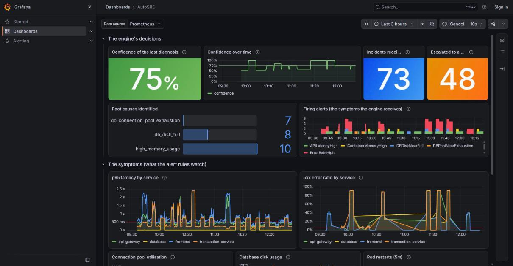
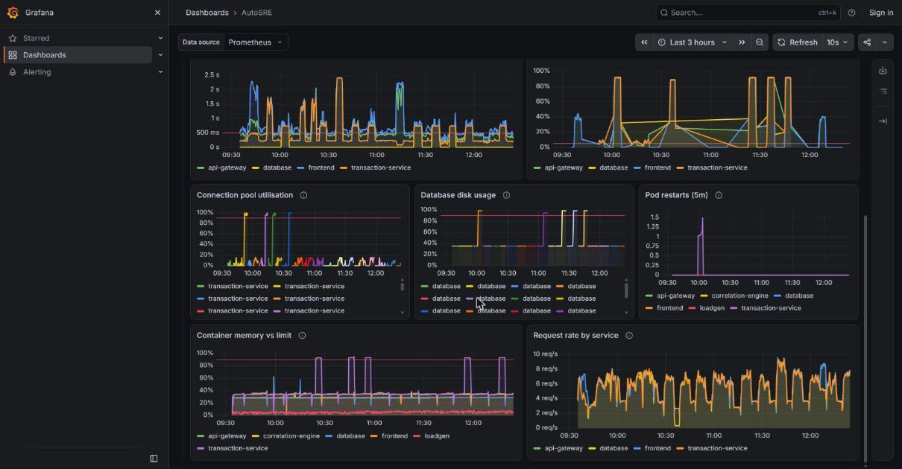

# Correlation engine - evaluation

How well does the engine name root causes, how was that measured, and what can and
cannot be concluded from it. Written by the ML role; see `correlation-engine/`.

> **Read this first.** Every number below, except the [Live validation](#live-validation)
> section, was measured on **simulated** incidents. They
> show how the engine behaves when symptoms drop out, cascade and get buried in noise.
> They are **not** an accuracy figure for real banking incidents, because the simulator
> and the signatures were written by the same person. Real numbers need incidents
> captured from a live cluster - the small run in [Live validation](#live-validation) is a
> start, not a rate.

## What the engine is

A deterministic, rule-based expert system. **There is no trained model in the shipped
engine.** The knowledge is hand-encoded: the dependency chain (`dependency_graph.py`),
one signature per root cause (`signatures.py`), and the arithmetic in `correlate.py`.

The brief calls for this ("rule-based, not ML, unless time allows"), and it is also the
defensible choice for a bank: the engine produces an auditable sentence such as

> transaction-service is the deepest alerting service in the chain; its deciding symptom
> DBPoolNearExhaustion fired; 4 of 4 expected symptoms present (...); confidence 100%.

A learned score of 0.91 explains nothing to an auditor. A classifier was still trained as
the brief's stretch goal, to see whether it would be better - it was not safer
([below](#would-a-learned-model-be-better)).

## The confidence model

The brief suggests `matched / expected`. Over four symptoms that can only produce
25 / 50 / 75 / 100 %, and it treats the deciding symptom as no more informative than a
downstream consequence. Each symptom instead carries a weight:

    confidence = sum(weights of symptoms that fired) / sum(all weights)

| cause | deciding symptom | consequences |
|---|---|---|
| `db_connection_pool_exhaustion` | DBPoolNearExhaustion **0.55** | ErrorRateHigh 0.20, PodRestartsHigh 0.15, APILatencyHigh 0.10 |
| `high_memory_usage` | ContainerMemoryHigh **0.60** | PodRestartsHigh 0.25, APILatencyHigh 0.15 |
| `db_disk_full` | DBDiskNearFull **0.60** | ErrorRateHigh 0.25, APILatencyHigh 0.15 |

The deciding symptom carries most of the weight because it is the one that distinguishes
this cause from every other; the rest are consequences that several causes share. The
score is still a plain ratio that can be printed back as a sentence.

Consequences:

- A cause cannot be named at all unless its deciding symptom fired **on the service that
  owns it** (`required_symptoms`). Confidence only ranks matches; it never creates one.
- A lone deciding symptom scores 0.55-0.60, below the dispatcher's planned 0.75 gate, so
  it escalates rather than acts.
- The brief's example of "91%" is reachable only by luck of weights. The demo scenario
  (all four symptoms) scores **100%**; losing the latency symptom scores **90%**. Put the
  number the engine actually produces on the slide.

## How the engine decides

1. Alertmanager groups alerts into one incident (`group_wait: 30s`) - algorithm step 1 is
   configuration, not code.
2. Map each alert's `service` label to its depth in the chain; ignore unknown services.
3. The **deepest** alerting service is the candidate root.
4. A signature matches only if its deciding symptom fired on that service.
5. Score it. If nothing matches, return `None`, which means **escalate to a human**.

**It fails safe.** If the deepest alerting service has no matching signature, the engine
escalates; it does *not* fall back to a shallower service that does match. A deeper
service alerting for an unknown reason is the likeliest true cause, and acting on a
shallower one would restart the wrong thing. Whether that is the right trade is measured
[below](#fail-safe-versus-fall-back) and turns out to depend on an unknown.

## How it was measured

```bash
cd correlation-engine
pip install -r requirements-dev.txt
python evaluation/evaluate.py --difficulty moderate --n 5000 --seed 7
python evaluation/evaluate.py --difficulty hard     --n 5000 --seed 7

pip install -r requirements-ml.txt                  # classifier only
python evaluation/train_classifier.py
```

The simulator (`evaluation/simulate.py`) builds incidents of five kinds: one per known
cause, an `unknown` fault no signature describes, and a `deep_fault` (the database
degrades and starves the transaction service's pool - the pool alerts are real but are a
*symptom*, so restarting the transaction service is the wrong fix). Symptoms drop out,
errors cascade up the chain, and noise includes unrelated alerts and occasionally a
different cause's deciding symptom (a *confounder*). The label is the cause that was
injected.

Plain accuracy hides what matters, so outcomes are split four ways, and the headline is
the **wrong-action rate**:

| outcome | meaning | cost |
|---|---|---|
| correct action | named the true cause | none |
| correct escalation | no known cause, and it escalated | none |
| missed | a known cause existed, but it escalated | a human's time |
| **wrong action** | named a cause that was not the true one | a human's time **and** a wrong playbook may have run |

Both of the above run against the engine exactly as shipped.

## Results

Full output for both noise levels is in the [appendix](#appendix-full-output). Headlines:

| | moderate noise | hard noise |
|---|---:|---:|
| accuracy | **89.9%** | **76.9%** |
| correct actions | 64.3% | 51.5% |
| missed (escalated a known cause) | 8.7% | 17.6% |
| **wrong actions** | **1.5%** | **5.5%** |

Clean data (every symptom, no noise) gives 100% accuracy, which is the expected sanity
check and is enforced by a test.

### Where the failures come from

Every failure is attributed to a cause using metadata the simulator records, and the
"unexplained" bucket is asserted empty by a test - if the simulator and engine ever
disagree about something, the build breaks instead of the numbers quietly drifting.

- **Misses** come from two sources: the deciding symptom never fired (an alert flapped),
  and an unrelated alert on a deeper service blocked the match. Both are the engine
  declining to guess, which is by design.
- **Every wrong action** in both runs came from one situation: a second cause's deciding
  symptom was also present. Two independent deciding symptoms firing together means two
  faults, or one fault plus a misleading signal; the engine picks one by score.

### The confidence score does not catch the wrong actions

| | correct | wrong |
|---|---:|---:|
| mean confidence, moderate | 0.93 | 0.84 |
| mean confidence, hard | 0.86 | 0.81 |

A wrong call looks almost as confident as a right one, because confidence measures how
*complete* the symptom set is, not whether the diagnosis is right. A confounded incident
can look complete. In practice:

- a gate of **0.75** (the planned dispatcher default) removes few wrong actions - on hard
  data 275 become 220;
- a gate of **0.90** cuts them to 82 but also cuts automation to 25% of incidents.

**The gate is weaker protection than it appears.** Do not describe it to the examiner as
a safety mechanism without this caveat.

### Fail safe versus fall back

The engine's refusal to act when the deepest alerting service is unexplained is a design
choice, so it was tested against the obvious alternative (walk up to a shallower match).
On the moderate data:

| engine | correct actions | missed | wrong actions |
|---|---:|---:|---:|
| fail safe (shipped) | 3214 | 434 | 73 |
| fall back to shallower | 3468 | 179 | 455 |

That 6x difference in wrong actions **depends entirely on how often deeper faults occur**,
which is an assumption (8% in the simulator), not a measurement. Varying it:

| deep-fault share | engine | correct actions | missed | WRONG ACTION rate | wrong actions (count of 20,000) |
|---:|---|---:|---:|---:|---:|
| 0% | fail safe | 69.9% | 9.0% | 1.7% | 336 |
| 0% | fall back | 75.1% | 3.7% | 1.7% | 345 |
| 1% | fail safe | 69.0% | 8.9% | 1.6% | 325 |
| 1% | fall back | 74.2% | 3.7% | 2.7% | 534 |
| 2% | fail safe | 68.5% | 8.8% | 1.7% | 332 |
| 2% | fall back | 73.7% | 3.6% | 3.6% | 714 |
| 4% | fail safe | 66.8% | 8.8% | 1.6% | 316 |
| 4% | fall back | 72.0% | 3.5% | 5.4% | 1076 |
| 8% | fail safe | 64.3% | 8.3% | 1.6% | 312 |
| 8% | fall back | 69.2% | 3.4% | 9.1% | 1821 |

Reading it honestly:

- With **no** deeper faults, fall-back is strictly better: about 5 points more automation
  and the same wrong actions.
- Every additional 1% of deeper faults adds roughly 1 point of wrong actions to fall-back,
  while fail-safe stays flat at 1.6-1.7%.
- So fail-safe costs about 5 points of automation to avoid roughly 1 wrong action per
  100 incidents for each 1% of deeper faults.

Which is better is a **judgement about cost**, not something the data settles: how
expensive is a wrong playbook on payment infrastructure compared with paging an engineer?
For a banking system fail-safe is the defensible default, and it is what ships - but the
team should say that it is a judgement and know the real deeper-fault rate is unmeasured.

### Would a learned model be better?

The brief's stretch goal: a scikit-learn decision tree trained on labelled incidents
(labels are free - every injected fault is known).

Trained on 8000 simulated 'moderate' incidents (seed 1), max depth 8, 86 leaves. Tested on fresh incidents from different seeds.

**SIMULATED data throughout - see the caveat at the top of this file.**

| test set | model | accuracy | correct actions | missed | WRONG ACTIONS |
|---|---|---:|---:|---:|---:|
| moderate, new seed | hand-written rules | 90.5% | 64.0% | 8.0% | 1.5% |
| moderate, new seed | decision tree | 94.9% | 69.8% | 2.6% | 2.5% |
| hard (harder than training) | hand-written rules | 77.8% | 51.9% | 17.6% | 4.6% |
| hard (harder than training) | decision tree | 85.1% | 61.1% | 8.7% | 6.2% |

#### What the tree relied on

| feature | importance |
|---|---:|
| DBDiskNearFull@database | 0.325 |
| ContainerMemoryHigh@transaction-service | 0.310 |
| DBPoolNearExhaustion@transaction-service | 0.169 |
| deepest_service_depth | 0.116 |
| PodRestartsHigh@transaction-service | 0.020 |
| ErrorRateHigh@transaction-service | 0.016 |
| APILatencyHigh@api-gateway | 0.013 |
| ContainerMemoryHigh@database | 0.011 |

The full tree can be printed with `python evaluation/train_classifier.py`.

The tree wins on accuracy and on misses, and **loses on the metric that matters**: it
makes more wrong actions than the rules, on both test sets. It learned the simulator's
noise statistics and acts despite unexplained deeper alerts - the same trade as the
fall-back variant. Some of its splits are on `n_alerts`, a quirk of how the simulator
happens to count alerts that would not carry over to a real cluster.

> **Correction to an earlier prediction.** Before running this I expected the tree to
> "rediscover the hand-written rules and score near-perfectly". It did not: it scored
> higher on accuracy and lower on safety. Accuracy alone would have called the tree the
> winner.

The rules therefore stay the default. A tree trained on simulated data can only learn the
simulator back, so this comparison is only meaningful once repeated on captured incidents.

## Limitations

- **Simulated data.** Symptom behaviour, noise rates and the mix of incident kinds are all
  assumptions. The deeper-fault share in particular is unknown and drives one of the
  findings.
- **Same author.** The signatures and the simulator share a mental model, so some
  agreement between them is guaranteed.
- **Three causes.** With so few, a hand-written table is hard to beat. The case for a
  learned model strengthens only as the number of causes grows.
- **The metrics are synthetic.** Timing figures (microseconds per incident) are real, but
  say nothing about end-to-end remediation time, which is dominated by the 30s
  `group_wait` and the playbook run.
- **Confidence is uncalibrated.** It is a completeness ratio, not a probability, and
  should not be presented as one.

## Recommendations

1. **Treat two simultaneous deciding symptoms as ambiguity and escalate.** All remaining
   wrong actions come from exactly this. It is implemented but **off by default**
   (`ESCALATE_ON_AMBIGUITY=true` turns it on; `correlate(..., escalate_on_ambiguity=True)`), and the
   simulator cannot validate it: it creates confounders by exactly this mechanism, so the rule
   would show zero wrong actions by construction - a number that proves nothing. It is a sound
   safety rule on its own merits; the cost is more escalations when two real faults coincide.
   Switching it on is the team's decision.
2. **Measure the real deeper-fault rate** before relying on the fail-safe finding.
3. **Set the dispatcher's confidence gate with the caveat above.** 0.75 is a sanity floor,
   not a safeguard.
4. **Read the live validation** below alongside the simulated figures; it is a small, single-cause, injected-fault run.

## Live validation

Run on 2026-10-31 on a single `t3.large` (minikube + kube-prometheus-stack), through the real
Prometheus → Alertmanager → engine pipeline. The faults were **injected** through the
`CHAOS_ENABLED` endpoints; everything downstream of the injection is real. So this measures
detection and correlation on staged faults - not whether real failures look like these.
The full generated report is [`live-validation/report.md`](live-validation/report.md), with
per-trial records in [`trials.jsonl`](live-validation/trials.jsonl).

**Sample size is small - treat it as anecdote, not a rate.** 18 trials were run, 17 usable
(trial 3 errored in the injector, see below): 4 pool exhaustion, 5 disk full, 5 memory
pressure, 3 "unknown" faults the engine should escalate.

### Result: the first webhook of each trial (what a dispatcher would act on)

| outcome | count |
|---|---:|
| correct action | 14 |
| correct escalation (unknown faults) | 3 |
| missed (escalated a known cause) | 0 |
| **wrong action** | **0** |

No wrong action in 17 trials. With n this small, the honest reading is "no counter-example
found", not "100% accurate": the faults were written by the same people who wrote the
signatures, each one isolates a single cause, and the three unknown faults were all
consequence-only (gateway latency or errors), so the live run never exercised the case the
simulation flagged as dangerous - a deeper fault with no signature, or two causes at once.

### Timing and the confidence gate

- A first incident reached the engine a median **83 s** after injection (range 60-140 s):
  15 s scrape + `for:` + the 30 s Alertmanager `group_wait`.
- The deciding symptom alerts **first and alone**, so the first webhook usually scores only
  0.55-0.60 (`DBPoolNearExhaustion` 0.55, `ContainerMemoryHigh`/`DBDiskNearFull` 0.60).
  A dispatcher gated at 0.75 would therefore wait for a later webhook: it acted at a median
  **138 s**, and in **4 of 14** known-cause trials (#2, #5, #6, #11) it never reached the
  gate at all. The 0.75 gate trades speed - and some automation - for caution; pool
  exhaustion at 19/20 connections produces too few consequences to clear it.
- A trial takes 8-10 minutes, not 6, because the rules use `rate(...[5m])`: latency and error
  alerts keep firing for about five minutes after a fault ends.

### The "every record" figure is not an accuracy

The report also scores every webhook, giving 61.5% with 20 "missed". That number is an
artefact and should not be quoted as accuracy: once the deciding alert clears, the lingering
consequence alerts (`APILatencyHigh`, `ErrorRateHigh`) still produce webhooks, and with the
cause gone the engine correctly escalates them. It shows the engine failing safe, and that a
dispatcher must treat "the cause already cleared" updates as noise rather than new incidents.

### What running it live found that the simulator could not

1. **Alerts never reached the engine.** `sum by (service)` drops the `namespace` label, and
   Alertmanager only routes `namespace = "autosre"`. Every rule now sets it explicitly, and a
   test enforces it.
2. **Grafana was OOM-killed** (256Mi limit); raised to 768Mi.
3. **The memory injector killed its own target.** `kubectl exec` runs inside the container's
   memory cgroup, so the injector's overhead pushed the pod over its limit (exit 137, trial
   3). Injection now goes through the API-server proxy.
4. **The dashboard's "Escalated to a human" was wrong.** Resolved notifications were counted
   as failed diagnoses (48 shown after a handful of real escalations). Fixed with a
   regression test.

### Dashboard (M7)

All 13 panel queries return data on the live cluster (`live-validation/dashboard_check.txt`),
including the confidence panel with the 0.75 gate marked.




### Not in the repo

`incidents.jsonl` (the raw 52 captured webhooks, 223 KB) lives only in the S3 bucket
`autosre-validation-841736140404`; `report.md` is derived from it by
`evaluation/live_report.py`. Download it before deleting the bucket if you want to reproduce
the report.

## Third-party benchmark: RCAEval RE1

The simulation and the live run were both written by us. To test the approach on data we did
not write, we used [RCAEval](https://github.com/phamquiluan/RCAEval) RE1: 375 real fault
injections (373 loaded) across three systems - Online Boutique, Sock Shop, Train Ticket -
with five fault types (cpu, mem, disk I/O, delay, loss) and the faulty service labelled.
Full tables: [`rcaeval-results.md`](rcaeval-results.md). Code: `evaluation/rcaeval_eval.py`.

RE1 is raw 1-second metrics, not alerts, so each metric is scored by how far the first five
minutes after injection sit from its own normal behaviour, and those scores replace "which
alerts fired". Two diagnosers see only those scores:

- **Replay baseline** - rules in the style of `correlate.py`, written before looking at the
  results: resource symptoms outrank latency; latency with errors is loss, latency alone is
  delay; nothing firing escalates. Only the threshold was chosen, on Online Boutique, and
  then frozen.
- **Learned model** - a random forest ranks services as the root cause, then a calibrated
  gradient-boosted classifier names the fault. Features are system-agnostic, and the
  evaluation is **leave-one-system-out**, so every test system is unseen in training.

| | wrong action | right action | escalates |
|---|---:|---:|---:|
| Replay baseline (373 cases) | 106 (28%) | 138 (37%) | 129 (35%) |
| Learned, always acts | 145 (39%) | 228 (61%) | 0 |
| Learned, acts at confidence >= 0.5 | 60 (16%) | 133 (36%) | 180 (48%) |

**Read this as a modest result, not a win.**

- **The learned model only beats the rules on coverage.** Forced to act on everything it is
  right 61% of the time and wrong 39%, which is worse than the rules' wrong-action rate.
  Gated at 0.5 it matches the rules' right actions with fewer wrong ones (16% vs 28%), but
  the gate is blunt: calibration error fell from 0.20 to 0.12 after fitting a calibrator on
  out-of-fold predictions, yet confidence still barely separates right from wrong at the
  high end (14% precision at 0.7, on 7 cases).
- **Most errors are confusions the data cannot resolve.** Service localisation is good
  (about 90% top-1). The fault type is not: cpu is called disk 48 times out of 74, disk is
  called cpu 21 times, and delay and loss swap places 22 and 21 times. RE1 has no disk
  metric and its error metrics never move, so CPU stress and disk I/O stress look alike, and
  so do delay and loss. More modelling will not fix missing signal.
- **The baseline's wrong assumptions are informative.** Its "latency plus errors means loss"
  rule was wrong for this data (errors stay flat), so it named no loss correctly. The rules
  also fail across systems: Online Boutique (where the threshold was set) shows 13 wrong
  actions, Sock Shop 60. A threshold chosen on one system does not transfer.
- **Memory faults are the clear success.** 99% right in the learned model, because memory
  stress is the one fault with its own distinct signature.
- **The tiny improvements were not kept.** Variability features gave no reliable gain on the
  development systems (Online Boutique and Sock Shop) and are off by default.

What this does *not* show: RE1's disk faults are I/O stress, not "disk full", and there is
no pool-exhaustion equivalent, so these numbers say nothing about our three causes in
particular. The faults are also injected for 35 minutes into otherwise clean systems. Two
disclosures on method: the threshold grid was widened after the first run because every
value then sat at its upper edge, and Train Ticket's numbers were visible during that
iteration; later design decisions used only Online Boutique and Sock Shop.

### RE2: adding disk-I/O and socket metrics, and logs

RE2 (270 cases: 15 per fault per system, six faults including a socket fault) has two metrics
RE1 lacked, `diskio` and `socket`, plus container logs. The rules were extended before
running (a disk-I/O symptom means disk, a socket symptom means socket); the "latency plus
errors means loss" rule was left as it was, although RE1 had already shown it wrong.
Tables: [`rcaeval-re2-results.md`](rcaeval-re2-results.md) (metrics) and
[`rcaeval-re2-logs-results.md`](rcaeval-re2-logs-results.md) (metrics plus logs).

| | wrong action | right action | escalates |
|---|---:|---:|---:|
| Replay baseline (270 cases) | 129 (48%) | 136 (50%) | 5 (2%) |
| Learned, always acts | 98 (36%) | 172 (64%) | 0 |
| Learned, acts at confidence >= 0.6 | 32 (12%) | 83 (31%) | 155 (57%) |
| Learned, acts at confidence >= 0.9 | 2 (1%) | 9 (3%) | 259 (96%) |

- **The new metrics helped where the signal exists.** Disk faults rose from confused with CPU
  (65%) to 78% right once `diskio` was available, and the fault is now properly separable
  from CPU stress. Confidence also became usable: precision of acted-on cases rises with the
  gate (69% at 0.5, 72% at 0.6, 82% at 0.9), the first time it has behaved like a gate.
- **The rules got worse, not better.** Adding symptoms to hand-written rules without
  fitting them produced more wrong actions (48%), because the symptoms overlap: memory
  stress also moves disk I/O, and CPU stress moves sockets. This is the clearest case so far
  for learning the weights rather than writing them.
- **Logs did not help.** Adding log-volume and error-line features gave 63.0% right, against
  63.7% without. The features are crude (volume and keyword counts), so this says logs *as
  summarised here* add nothing, not that logs cannot help. Traces (2.5 GB, not downloaded)
  were skipped for the same reason.
- **Remaining confusions are physical overlaps.** Memory stress is called disk 15 times in 45
  (it drives I/O), delay and loss swap 8-12 times, and CPU and socket swap 7-11 times.

## Second opinion from raw metrics

The rule engine reasons over alert *names*. A second service, `second-opinion/`, looks at the
metrics underneath them and says whether it agrees on where the fault is. It is wired in as
a check on the rules' decision, not as a second decision-maker.

**How it works.** After the rules name a cause, the engine POSTs `{root_cause, service,
incident_start}` to the scorer. The scorer pulls the incident window from Prometheus (cpu,
memory, p95 latency, 5xx ratio, request rate for each of the four services), scores each
service against its own earlier behaviour, and a model trained on RCAEval RE1 names the most
likely faulty service and fault type. The verdict is `agree`, `disagree` or `no_opinion`.

**Why a separate service.** scikit-learn does not fit in the engine's 128 Mi limit, and a
separate read-only service keeps the engine pure and lets the scorer fail without taking the
decision path down. The engine calls it with a short timeout and treats any failure as
`unavailable`: a dead, slow or confused scorer never blocks an incident.

**Modes** (`SECOND_OPINION_MODE` on the engine; the URL being unset turns it off):

| mode | effect |
|---|---|
| `shadow` (default) | the verdict is added to the webhook response and counted in `second_opinion_verdicts_total`; the decision is unchanged |
| `gate` | on `disagree` the engine withholds the action and escalates (`status: vetoed`, counted in `vetoed_incidents_total`); `agree`, `no_opinion` and `unavailable` all proceed |

**What it can and cannot confirm.** The model's fault vocabulary is RCAEval's (cpu, mem, disk
I/O, delay, loss), which does not match ours:

- `high_memory_usage` is checked on service **and** fault type (`mem`, which the model gets
  99% right on held-out systems).
- `db_disk_full` and `db_connection_pool_exhaustion` have no matching fault type, so only the
  **service** is compared. That is still independent evidence, since it uses raw metrics
  rather than the alerts, but a weaker check. The scorer cannot see disk usage or pool
  gauges at all.

**How good is the model?** It is trained on RE1 only, because RE1 has exactly the five
signals our cluster exposes, and without features that depend on how many services a system
has (RCAEval's have 12-100+, ours has four). Leave-one-system-out on 373 cases:

| | service top-1 | fault right | both right |
|---|---:|---:|---:|
| all services present | 90.9% | 66.8% | 61.4% |
| cut down to four services | 95.4% | 71.0% | 68.4% |

Naming the *service* is the strong part, which is what the check mostly relies on.

**What is not validated.** This is a transfer from three open-source demo systems to ours,
and none of the following has been run:

- The scorer has never been run against our cluster; the Prometheus queries, the
  `container`/`service` label assumptions and the `second-opinion` image have only been tested
  against fakes (14 service tests, 8 engine tests; five deliberately broken variants were all
  caught). Docker was not available where this was built.
- Our faults are staged by chaos endpoints in a 15-second-scrape setup, unlike RCAEval's
  1-second data, and the incident-start estimate is "earliest alert minus two minutes".
- Whether it *helps* is unknown. That is why `shadow` is the default.

**Checked without a cluster.** `second-opinion/e2e_smoke.py` runs the engine, the scorer and a
fake Prometheus as real servers over HTTP and checks five things: the scorer agrees with a true
diagnosis, disagrees with a wrong one, the engine vetoes the wrong one in gate mode, acts on the
true one, and carries on when the scorer is dead. It passes, deterministically. It also showed how
sensitive the scorer is to what a fault looks like: a memory fault that moved cpu, memory and
latency together scored 0.79 and was recognised, while the same memory pressure with cpu and
latency flat scored 0.38-0.48 and was once attributed to the wrong service. Real RCAEval memory
faults look like the first; whether ours do is exactly what the live run must show.

### Second opinion: live result (it does not pass)

Run on AWS on 2026-11-07: 15 injected-fault trials (5 memory, 5 disk, 3 pool, 2 unknown), scorer in
`shadow` mode. The rules were again never wrong (13 correct actions, 2 correct escalations, 0 wrong
actions; with the first run that is 32 trials and 0 wrong actions). Full report:
[`live-validation-run2/report.md`](live-validation-run2/report.md).

| | result |
|---|---|
| on the engine's 13 correct decisions | agree 3, **disagree 8**, no opinion 2 |
| asked about a **true** diagnosis (26 probes) | agree 9, disagree 15, no opinion 2 |
| asked about a deliberately **wrong** diagnosis (30 probes) | agree **0**, disagree 27, no opinion 3 |

It is a one-sided verifier: it never endorsed a wrong claim, but it rejected most true ones. In `gate`
mode it would have **withheld 8 of 13 correct actions** (62%) to guard against wrong ones that never
occurred. **Do not enable `gate`.** It stays in `shadow`, where it does no harm, but it is not evidence
for the diagnosis.

Why, from the scorer's own output:

- **The right service only 62% of the time** (16 of 26 true-claim probes), against 91-95% on the
  RCAEval systems it was trained on. Latency propagates up the chain, so the scorer often blames
  `frontend` or `api-gateway` for a fault in `transaction-service` or `database`.
- **It sees almost everything as packet `loss`.** Our staged faults are latency-led, and `loss`
  was its answer in nearly every probe. Memory pressure was recognised as `mem` in 1 of 5 trials,
  although that is the one cause the check compares on fault type as well as service. The model's
  best fault in testing (memory, 99% on RCAEval) was its worst here.
- **It is rarely confident.** Calibrated confidence was at most 0.69 in 28 of the 30 probe moments (only one disk trial reached 0.82), and 3 moments abstained.
- **Same output for true and wrong claims.** The verdict depends only on whether the scorer's
  service equals the claimed one. A wrong claim names a service that is not faulty, so it is
  rejected whenever the scorer does not happen to point at that same quiet service, which is almost
  always. The 27-of-30 figure therefore mostly reflects how the wrong claims were chosen, not
  insight; the 9-of-26 on true claims is the informative number.

This is the transfer problem the earlier sections warned about, now measured: a model that is
99% right on memory faults in three open-source systems does not carry over to a four-service system
with different metrics, a 15-second scrape and faults of a different shape. The next step, if the
second opinion is worth pursuing, is to train on **our own** labelled metric windows (the harness
would need to record the score vectors it probes with), not to tune the RCAEval model further.

**Process finding.** The live run also caught a deployment bug no test had: the engine's
`Dockerfile` copied four named modules and not the new `second_opinion.py`, so the engine pod
crash-looped on start. `tests/test_dockerfile.py` now checks that every module reachable from
`app.py` is copied into its image, for both services.

### A scorer trained on our own incidents (run 3)

The RCAEval model did not transfer, so the scorer was retrained on this system's own faults.
`live_validate.py --collect` injects each fault and records the scorer's feature table at 150 s and
270 s after injection (no alert waiting, 6 min 15 s a trial). The scorer service has a `/features`
endpoint and two signals RCAEval has no equivalent of, `db_disk_usage_ratio` and
`db_connection_pool_active`. `second-opinion/train_own.py` trains on those tables.

Collected on AWS on 2026-11-10: **29 trials, 58 windows, no errored trial** (8 pool, 8 memory,
7 disk, 6 unknown; one disk trial short of the plan because the lab session ended). Data:
[`live-validation-run3/trials.jsonl`](live-validation-run3/trials.jsonl) (scores rounded to 2 decimals).
Every figure below is leave-one-trial-out: both windows of a trial are held out together.

| | RCAEval model, live (run 2) | own-data model, held out (run 3) |
|---|---|---|
| right service | 62% (16 of 26) | **86%** (50 of 58) |
| right service and cause | not comparable | **86%** (50 of 58) |
| asked about a **true** diagnosis | agree 9, disagree 15, no opinion 2 | agree **46**, disagree 0, no opinion 0 |
| asked about a **wrong** diagnosis | agree 0, disagree 27, no opinion 3 | agree **0**, disagree 53, no opinion 5 |

By fault: pool exhaustion 16 of 16, high memory 16 of 16, disk full 14 of 14, unknown gateway fault
**4 of 12**. All 8 misses are the unknown fault: the model names it `gateway_fault` but points at
`database` or `frontend`. Six of the eight have confidence 0.13-0.35; trial 6 is wrong at 0.81-0.85.
That fault has no rule and so no claim to check, which is why it does not appear in the verdict rows.

What this does and does not show:

- On the three causes the rules act on, the scorer now backs every true claim and no wrong one.
  That is the property the RCAEval model lacked.
- It is a held-out estimate from one session, not a live shadow run. The model has not yet been
  deployed and asked about incidents as they happen.
- Faults were injected back to back, so each one's 30-minute baseline contains earlier faults and the
  z-scores are attenuated (pool 2-3 in five of the eight pool trials, against 19 in trial 1, the only
  one with a clean baseline). The model learned
  thresholds on the attenuated values, so a clean baseline should be easier, but that is untested.
- 29 trials is small; one more session would firm up the unknown-fault figure.

`models/own.joblib` is now what the scorer image loads (`MODEL_PATH` in its Dockerfile), in shadow
mode. The live check below is the test the held-out figures could not be.

### Live check of the own-data scorer (run 4)

Run on AWS on 2026-11-11 with the same harness and the own-data model in `shadow` mode: 14 trials run,
12 usable (2 excluded because the previous trial's alerts were still firing). Report:
[`live-validation-run4/report.md`](live-validation-run4/report.md). The rules again made **no wrong
action** (9 correct actions, 2 correct escalations, 1 miss in 12 first decisions; 0 wrong actions across
all 40 records).

| | RCAEval model (run 2) | own-data, held out (run 3) | own-data, **live** (run 4) |
|---|---|---|---|
| asked about a **true** diagnosis | agree 9 of 26 | agree 46 of 46 | agree **16 of 20**, disagree 2, no opinion 2 |
| asked about a **wrong** diagnosis | agree 0 of 30 | agree 0 of 58 | agree **0 of 24**, disagree 22, no opinion 2 |
| on the engine's correct decisions | agree 3, **disagree 8**, no opinion 2 | n/a | agree 4, **disagree 4**, no opinion 1 (of 9) |

Live it is clearly better than the RCAEval model (true claims backed 80% against 35%, false vetoes on
the engine's decisions 4 of 9 against 8 of 13) and it still never endorsed a wrong claim. It is also
clearly worse than the held-out figures promised, and **it still does not pass for `gate` mode**: it
would have withheld 4 of 9 correct actions.

The four false vetoes, from the report: trials 5 and 8 (disk, pool) read as `gateway_fault`, trial 6
(pool) as a database fault, trial 14 (memory) as pool exhaustion. Trial 1 abstained because the cluster
had under 12 baseline samples. What explains the gap, in order of confidence:

- **The unknown-fault class absorbs real faults.** It was already the weak class in run 3 (4 of 12
  right) and two of the four vetoes name it.
- **The baseline differs from training.** Both runs inject faults back to back, but the live trials
  ran a different cause order and each trial's 30-minute baseline holds different earlier faults, so the
  attenuated z-scores the model learned thresholds on do not repeat.
- **Few trials.** 29 training trials, and some causes had 4-7.

So the held-out number overstated how well the model transfers to a *new session*. The honest figure
for "how often does it back a true diagnosis" is the live 80%, from 20 probes.

**Decision: `SECOND_OPINION_MODE` stays `shadow`.** To make it gate-worthy: collect on a clean
baseline (reset and settle 30 minutes between trials, or a robust baseline), train on run 3 and run 4
together (about 41 trials), and score on a third session it has never seen.

### Trying to improve it (run 5): more data, other datasets, earlier windows

Run 4 showed the held-out figure did not carry over live, so the next step was to find out why and to
use every dataset available. Each result below is held out one trial at a time unless said otherwise.

| Tried | Result |
|---|---|
| Train on run 3 only, test on run 4 (a different session) | 86% right service, backs 18 of 18 true claims |
| Signed-log squash of the scores (tames the 10000 clip) | no change |
| Add RCAEval cases to the service ranking (40 per system, four-service view, weights 0.3 and 1) | **worse**: 77-82% against 86% across sessions; 81% against 91% on runs 3+4 combined; true claims backed 54 of 58 against 58 of 58. Left out |
| Windows at 75, 90, 105, 120 s after injection (7 new trials, `live-validation-run5-early/`) | the run 3+4 model scores the same on them as on the 150 s+ windows (86% at every window, 30 of 30 true claims backed), so **"the engine asks too early" is not the explanation** |
| Train on runs 3, 4 and the early windows together (**47 trials, 115 windows**) | **94.8%** right service, **92.2%** right service and cause; backs 90 of 94 true claims; **2 of 115 wrong claims were also backed** (the first time it endorsed a wrong one) |

The RCAEval benchmark does not help because its systems have 12-100+ services, different metrics and
no `disk` or `pool` signal; it teaches the ranking to look for patterns ours do not have. The data from
our own system is what moves the number.

**What is still unexplained: why live disagrees with the stored probes.** The scorer backs the true
claim at the harness's probe moments and vetoed 4 of 9 of the engine's own calls in the same trials.
The two paths differ in one input: the harness passes `injection + 60 s` as `incident_start`, the engine
passes the earliest alert's `startsAt` (`second_opinion.earliest_start`), and the scorer treats
`incident_start - 60 s` as when the fault began (`LEAD_SECONDS`). `startsAt` depends on each alert's `for:`
delay, so the scored window starts at a different, alert-dependent time than any training window did.
That fits the pattern but **has not been tested**. `live_validate.py --collect --start-offsets 30,60,90,120`
now records the table at several such starts so the next collection can cover the spread and the claim
can be checked.

The 92% figure is therefore a held-out estimate on injected faults, not a live one; the live result
(run 4, 80% of true claims backed, 4 of 9 correct decisions vetoed) stands until a new live run says
otherwise. `models/own.joblib` is retrained on all three datasets. `SECOND_OPINION_MODE` stays `shadow`.

### Live check of the retrained scorer (run 7)

The retrained model was run live in shadow mode on a fresh instance (`docs/live-validation-run7/summary.md`).
Seven trials ran before the deadline (a stuck `APILatencyHigh` alert made each wait 10-25 minutes; one trial
was excluded because no incident arrived); six are usable.

| | run 4 (run 3 model) | run 7 (retrained) |
|---|---|---|
| true claim backed at the probe moments | 16 of 20 | **12 of 12** |
| wrong claim caught at the probe moments | 22 of 24 | **12 of 12** |
| first engine decision vetoed (all were correct) | 4 of 9 correct decisions | **3 of 6** |

The probes improved; the engine path did not. The scorer agrees with the true claim every time the harness
asks, and disagrees with the engine's identical, correct call about half the time (trial 5: three
consecutive vetoes, "looks like gateway_fault", for a pool-exhaustion incident). The only input that
differs is the start time passed in. **`SECOND_OPINION_MODE` stays `shadow`.**

**Checked against the stored incidents: the start time the engine passes is the cause, but the reason is
a stale alert, not the `for:` delay.** `earliest_start` is the earliest `startsAt` among *all* firing
alerts in the webhook. In run 7 an `APILatencyHigh` that was still firing from the previous trial
was in most payloads, so the "incident start" was minutes before the fault. Each record, with
`startsAt` minus the injection time:

| trial | `startsAt` − injection | verdict |
|---|---:|---|
| mem 1 (three records) | -788 s | no_opinion (also too few baseline samples) |
| pool 4 (three records) | **-737 s** | disagree, disagree, disagree |
| mem 5, first record | **-98 s** | disagree |
| mem 5, second record | +71 s | agree |
| disk 3, first record | +4 s | disagree |
| disk 3, second record | +69 s | agree |
| disk 2 | +78 s | agree |
| mem 6 (two records) | +77 s | agree, agree |

The split is clean: every record whose start fell 69-78 s after the injection (what the model was trained on)
was backed; every record with a start before the fault, or only 4 s after it, was vetoed. The last one is a
second effect: `DBDiskNearFull` fires almost at once, so subtracting the fixed 60 s lead puts the window start
56 s before the fault. Six trials, so this is a pattern in a small sample, but it is consistent across all 13
records and it does not depend on the model.

**The fix (made, not yet run live).** The engine now estimates when the fault began from the *deciding*
symptom of the diagnosed cause (`required_symptoms`, e.g. `DBPoolNearExhaustion`), not from every firing alert,
and winds each alert back by its own `for:` delay plus 15 s for a scrape and an evaluation
(`correlation-engine/second_opinion.py: estimate_fault_start`; `FOR_SECONDS` is checked against
`monitoring/alert-rules.yaml` by a test). It sends that as `fault_start`, which the scorer uses as is; without
it the scorer keeps the old `incident_start - LEAD_SECONDS` rule (`second-opinion/app.py`).

Replaying the 13 stored run 7 records through the new estimate: the estimated fault start is within
**-8 s to +3 s of the real injection time in every record** (before: -788 s to +78 s). That checks the start
time, not the verdicts: the verdicts need the metrics replayed, or a new live run. The gate stays off until a
live run shows the vetoes gone.

### Live check of the fix (run 8)

A new live run with the fix (`docs/live-validation-run8/summary.md`; 6 usable known-cause trials, pods restarted
first so no stale alert was firing): **the scorer agreed with all 11 diagnosed engine decisions** (run 7: agree 5,
disagree 5, no_opinion 3), and with 6 of 6 first decisions (run 7: 2 of 6). The probes were again 12 of 12 true claims
backed and 12 of 12 wrong claims caught. The estimated fault start was within about ±25 s of the injection on every
scored record.

Two limits. Run 8 had no stale alert, so on its own it cannot tell the fix from the clean cluster; the fix itself is
supported by the run 7 replay (start times only), not by a controlled live comparison. And 11 decisions from 6 trials
is a small sample, with no unknown-cause trial finished to test escalation. **The gate stays off** until a run with a
stale alert left in place shows the fix alone keeps the verdicts correct, over more than six trials.

### Out-of-session check, and retraining on run 8

The model that was live in runs 7-9 (trained on runs 3, 4 and 5-early: 47 trials) was scored on the feature tables
of run 8, a session it never saw (`second-opinion/eval_session.py`, `docs/live-validation-run8/trials.jsonl`: 6
trials, 12 windows). **All 12 had the right service and the right fault** (the gateway fault too, at confidence
0.43), 10 of 10 true claims were backed, and 12 of 12 wrong claims were caught. This is a stricter test than the
leave-one-trial-out figures, which hold out one trial from sessions the model trained on, but it is one session and
12 windows.

The model was then retrained on all four sessions (**53 trials, 127 windows**; `models/own.joblib`):

| held out one trial at a time | before (47 trials, 115 windows) | after (53 trials, 127 windows) |
|---|---|---|
| right service | 94.8% | 95.3% |
| right service and fault | 92.2% | 93.7% |
| true claims backed | 90 of 94 | 100 of 104 |
| wrong claims endorsed | 2 of 115 | 2 of 127 |

Small gains from a few more windows. The retrained model has **not** been run live: the cluster in runs 7-9 used the
previous one, and `eval_session.py` on run 8 now reports in-sample numbers for it. The Docker image must be rebuilt
to pick it up (`second-opinion/Dockerfile` copies `models/own.joblib`).

### The stale-alert test (run 9, 6 trials)

With an `APILatencyHigh` deliberately left firing and aged for 120 s before the real fault, the same incident was
scored with the old and the new start (`docs/live-validation-run9/summary.md`; 6 trials).
The old start was 123-132 s before the fault and the scorer disagreed with the true cause in 10 of 12 probes; the new
start was within -9 s to +12 s, the scorer agreed in 12 of 12 and disagreed with the wrong claim in 12 of 12, and the
engine agreed in 6 of 6. This is the controlled comparison run 8 lacked, and it supports the fix as the cause of the
change. Six trials; it is the cause, shown in a controlled way, but not yet the bar below.

### The bar for gate mode

`SECOND_OPINION_MODE=gate` would let the scorer withhold the rules' action when it disagrees. Written down
before looking at more data, so the bar cannot move to fit the result. All of it must hold, on runs made
with the fault-start fix (earlier runs measured a bug):

| criterion | why this number |
|---|---|
| at least 3 separate live sessions | one session can share a lucky or unlucky cluster state |
| at least 40 judged correct decisions, 20 of them the first diagnosis of a trial | with 0 vetoes in 40, the 95% upper bound on the veto rate is about 9%; in 11 it is about 26% |
| 0 vetoes of a correct decision, upper bound at most 10% | a false veto withholds a correct fix; the scorer is only worth gating on if it almost never does |
| at least 40 probes, 95% of true claims backed | it must agree with what is true |
| at least 40 probes, 95% of deliberately wrong claims caught | it must disagree with what is false, otherwise it adds nothing |
| at least 5 unknown-cause trials, all escalated | the gate must not turn an escalation into an action; the engine decides that, so this checks the pipeline end to end |

`python evaluation/gate_check.py <results dirs>` checks a set of runs against this and exits non-zero unless
every line holds. At the time of writing only one post-fix session exists (run 8: 11 decisions, 6 trials), so
**the bar is not met and the gate stays off.** With runs 8 and 9 (`gate_check.py`, 2 post-fix sessions): 21 judged correct decisions (11 first decisions), **0 vetoes** (95% upper bound 15.5%), 22 of 22 true claims backed, 24 of 24 wrong claims caught, 1 of 1 unknown-cause trial escalated. What was missing then was volume: a third session, 40 decisions, 40 probes of each kind, and 5 unknown-cause trials.

**With run 11 added (3 post-fix sessions, `docs/live-validation-run11/summary.md`)**: 32 judged correct decisions (17 first decisions), **0 vetoes** (95% upper bound 10.7%), 34 of 34 true claims backed, 45 of 46 wrong claims caught, 6 of 6 unknown-cause trials escalated. Sessions, wrong-claim catch rate and unknown-cause criteria are met; **the bar is still not met** because three of run 11's 14 trials were marked contaminated and excluded, leaving 8 judged decisions (3 first decisions) and 6 true-claim probes short, and the veto upper bound just above 10%. Another clean session of about 9 known-cause trials should close the gap. The gate stays off.

**With run 12 added (4 post-fix sessions, `docs/live-validation-run12/summary.md`)**: 43 judged correct decisions (24 first decisions), **0 vetoes** (95% upper bound 8.2%), 48 of 48 true claims backed, 59 of 60 wrong claims caught, 6 of 6 unknown-cause trials escalated. `gate_check.py` reports **READY**: the bar as written is met. Two caveats are recorded with the result: the pooled evidence mixes the scorer deployed before retraining (run 8) with the retrained one (runs 11 and 12; run 9's model is not recorded), and runs 11 and 12 alone, the two sessions known to use the current model, give 22 decisions and an upper bound of 14.9%, which would not meet the bar by themselves. Five trials across those two sessions were marked contaminated and excluded. `SECOND_OPINION_MODE` remains `shadow`; turning the gate on is a separate decision.

## Appendix: full output

Regenerate with the commands under "How it was measured". Seed 7, 5000 incidents each.

### Simulated incidents - moderate

SIMULATED (seed 7). Noise: deciding symptom seen 95%, each consequence 80%, error cascades 70%, unrelated alerts 25%, confounding cause 5%. Measures robustness to noise, not real-world accuracy.

**5000 incidents.** Accuracy: **89.9%**

#### Outcomes

| outcome | count | share |
|---|---:|---:|
| correct action | 3214 | 64.3% |
| correct escalation | 1279 | 25.6% |
| missed (escalated a known cause) | 434 | 8.7% |
| WRONG ACTION | 73 | 1.5% |

#### Confusion matrix

| true \ predicted | db connection pool exhaustion | db disk full | high memory usage | escalate |
|---|---:|---:|---:|---:|
| **db connection pool exhaustion** | 1045 | 34 | 5 | 186 |
| **db disk full** | 2 | 1193 | 2 | 59 |
| **high memory usage** | 1 | 29 | 976 | 189 |
| **escalate** | 0 | 0 | 0 | 1279 |

#### Per class

| class | precision | recall | F1 | support |
|---|---:|---:|---:|---:|
| db_connection_pool_exhaustion | 99.7% | 82.3% | 90.2% | 1270 |
| db_disk_full | 95.0% | 95.0% | 95.0% | 1256 |
| high_memory_usage | 99.3% | 81.7% | 89.6% | 1195 |
| escalate | 74.7% | 100.0% | 85.5% | 1279 |

#### What a confidence gate buys

An action is taken only if a cause was named *and* confidence >= the gate; everything else escalates to a human.

| min confidence | automated actions | wrong actions | precision of actions | known incidents auto-remediated |
|---:|---:|---:|---:|---:|
| 0.00 | 3287 (65.7%) | 73 (1.5%) | 97.8% | 86.4% |
| 0.50 | 3287 (65.7%) | 73 (1.5%) | 97.8% | 86.4% |
| 0.75 | 3150 (63.0%) | 69 (1.4%) | 97.8% | 82.8% |
| 0.90 | 2186 (43.7%) | 27 (0.5%) | 98.8% | 58.0% |

#### Why the failures happened

**Missed (escalated a known cause)**

| reason | count |
|---|---:|
| an unrelated alert on a deeper service blocked the match | 255 |
| the deciding symptom never fired (alert flapped or was missed) | 179 |

**Wrong action**

| reason | count |
|---|---:|
| a second cause's deciding symptom was also present | 73 |

#### Design check: fail safe vs fall back

The engine escalates when the deepest alerting service has no matching signature. The alternative walks up to a shallower service that does match. Same data, both engines:

| engine | correct actions | missed | WRONG ACTIONS | wrong-action rate |
|---|---:|---:|---:|---:|
| fail safe (shipped) | 3214 | 434 | 73 | 1.5% |
| fall back to shallower | 3468 | 179 | 455 | 9.1% |

The fall-back variant recovers some missed incidents, and pays for it with wrong actions on incidents where a deeper fault is the real cause. Which wins depends on how often deeper faults actually occur - the share used here is an assumption (`simulate.KIND_MIX`), not a measurement.

#### Diagnostics

- mean confidence when correct: 0.93
- mean confidence when WRONG: 0.84 (73 cases)
- engine time per incident: 4 microseconds

### Simulated incidents - hard

SIMULATED (seed 7). Noise: deciding symptom seen 85%, each consequence 60%, error cascades 50%, unrelated alerts 50%, confounding cause 15%. Measures robustness to noise, not real-world accuracy.

**5000 incidents.** Accuracy: **76.9%**

#### Outcomes

| outcome | count | share |
|---|---:|---:|
| correct action | 2574 | 51.5% |
| correct escalation | 1270 | 25.4% |
| missed (escalated a known cause) | 881 | 17.6% |
| WRONG ACTION | 275 | 5.5% |

#### Confusion matrix

| true \ predicted | db connection pool exhaustion | db disk full | high memory usage | escalate |
|---|---:|---:|---:|---:|
| **db connection pool exhaustion** | 802 | 91 | 32 | 382 |
| **db disk full** | 4 | 1043 | 13 | 167 |
| **high memory usage** | 29 | 106 | 729 | 332 |
| **escalate** | 0 | 0 | 0 | 1270 |

#### Per class

| class | precision | recall | F1 | support |
|---|---:|---:|---:|---:|
| db_connection_pool_exhaustion | 96.0% | 61.4% | 74.9% | 1307 |
| db_disk_full | 84.1% | 85.0% | 84.6% | 1227 |
| high_memory_usage | 94.2% | 61.0% | 74.0% | 1196 |
| escalate | 59.0% | 100.0% | 74.2% | 1270 |

#### What a confidence gate buys

An action is taken only if a cause was named *and* confidence >= the gate; everything else escalates to a human.

| min confidence | automated actions | wrong actions | precision of actions | known incidents auto-remediated |
|---:|---:|---:|---:|---:|
| 0.00 | 2849 (57.0%) | 275 (5.5%) | 90.3% | 69.0% |
| 0.50 | 2849 (57.0%) | 275 (5.5%) | 90.3% | 69.0% |
| 0.75 | 2446 (48.9%) | 220 (4.4%) | 91.0% | 59.7% |
| 0.90 | 1262 (25.2%) | 82 (1.6%) | 93.5% | 31.6% |

#### Why the failures happened

**Missed (escalated a known cause)**

| reason | count |
|---|---:|
| the deciding symptom never fired (alert flapped or was missed) | 486 |
| an unrelated alert on a deeper service blocked the match | 395 |

**Wrong action**

| reason | count |
|---|---:|
| a second cause's deciding symptom was also present | 275 |

#### Design check: fail safe vs fall back

The engine escalates when the deepest alerting service has no matching signature. The alternative walks up to a shallower service that does match. Same data, both engines:

| engine | correct actions | missed | WRONG ACTIONS | wrong-action rate |
|---|---:|---:|---:|---:|
| fail safe (shipped) | 2574 | 881 | 275 | 5.5% |
| fall back to shallower | 2959 | 473 | 625 | 12.5% |

The fall-back variant recovers some missed incidents, and pays for it with wrong actions on incidents where a deeper fault is the real cause. Which wins depends on how often deeper faults actually occur - the share used here is an assumption (`simulate.KIND_MIX`), not a measurement.

#### Diagnostics

- mean confidence when correct: 0.86
- mean confidence when WRONG: 0.81 (275 cases)
- engine time per incident: 4 microseconds
